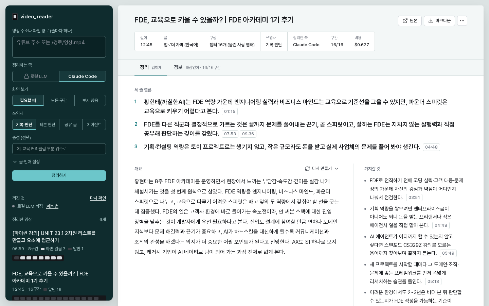
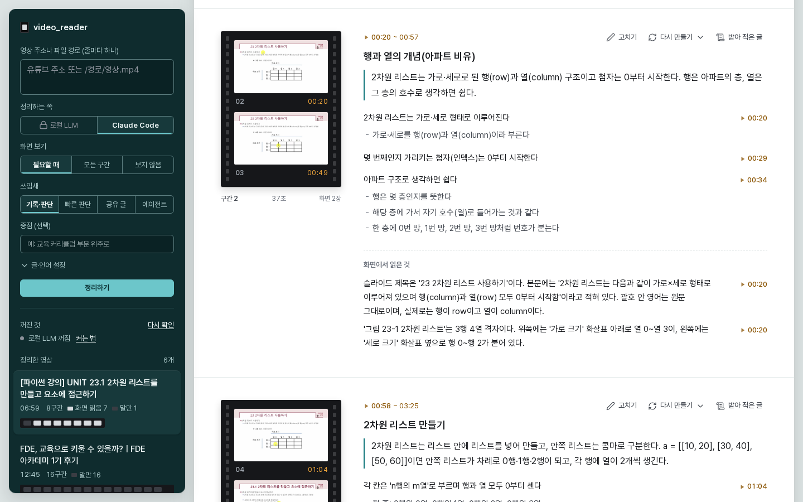

# video_reader — 영상을 읽고 구간별로 정리하는 에이전트

유튜브 주소나 이 PC의 영상 파일을 넣으면, 보지 않고도 내용을 알 수 있게 **시각이 달린 구간별 정리 + 전체 개요**를 만든다.
말에는 없고 화면에만 있는 것(슬라이드·그래프·코드)은 그 시각의 화면을 직접 읽어 넣는다.

- **글은 사람이 만든 자막부터**: 업로더 자막 → 파일 안 자막 트랙 → 옆의 `.srt/.vtt`. 유튜브 **자동 자막은 쓰지 않는다**.
  자막이 없으면 [stt 에이전트](../stt)에 A2A 로 받아 적기를 맡긴다 (이 PC 모델, 화자·문장 시각 포함).
- **정보와 정리를 따로 둔다**: "정보"는 빠짐없이(구간마다 결론 + 항목 아래 이유·사례·자료, 언급된 것, 원문 숫자·이름 누락 검사), "정리"는 읽히게(세 줄 결론·개요·구간별 한 줄·가져갈 것 — 줄마다 출처 구간). 정리는 정보에 없는 말을 쓰지 않는다.
- **stt 로 받아 적은 글은 이름·숫자를 바로잡는다**: 영상 설명·제목의 표기를 근거로 같은 대상일 때만 바로잡고, 근거 없는 사람·회사·책·강의 이름은 "받아 적기 확인 필요"로 표시. 자막이 있어도 stt 로(`transcribe: stt`), stt 의 예전 결과 말고 새로(`sttFresh`)는 켤 때만.
- **영상의 구성을 따른다**: 올린 사람의 챕터 → 없으면 말에서 질문·항목·단계의 경계를 찾고 → 못 찾으면 시간으로 자른다. 구간마다 결론 한두 줄과 주장/근거로 나뉜 요점, 맨 위에 세 줄 결론.
- **묻지 않고 기본값으로, 원하면 쓰임새·중점**: 쓰임새(기록·판단 기본 / 빠른 판단 / 공유 글 / 에이전트 입력)와 중점 한 줄을 고를 수 있고, 끝난 뒤 "다른 쓰임새로 다시 쓰기"는 글 층만 다시 쓴다(받아 적기·구간 정리는 그대로).
- **화면은 필요할 때만**: 말이 화면을 가리키는 구간("이 그래프를 보시면", 코드·표를 읽지 않고 넘어갈 때)만 그 시각의 프레임을 뽑아 읽는다. 모든 구간 / 보지 않음도 고를 수 있다.
- **정리하는 쪽 두 가지**: 로컬 LLM(vLLM, Qwen3.8-27B) 또는 Claude Code(headless `claude -p`). 작업마다, 구간마다 고른다.
- **쓰는 방법 셋**: 화면(사람) · A2A(다른 에이전트) · import·CLI. 셋 모두 같은 서비스 함수를 불러서, A2A 로 맡긴 일도 화면 목록에 보이고 사람이 이어서 고친다.

> 상태: 첫 버전 (2026-11-24). 아래 숫자는 그날 이 PC(RTX 4090)에서 잰 값 — 과정과 실패는 [`docs/history/2026-11-24_first-build/`](docs/history/2026-11-24_first-build/README.md).

| 영상 | 글 | 정리 | 시간 | 비용 |
|---|---|---|---|---|
| TED 14:04 (영어) | 업로더 자막 | Claude Code, 4구간·화면 7장 | 161초 | $0.495 |
| 파이썬 강의 6:59 (한국어, 자막 없음) | stt 약 45초 | 로컬 LLM, 2구간 | 103초 | 0 |

## 화면 — 밀착 인화지

영상 한 편이 인화지 한 장이다. 결과는 **정리**(읽히게)와 **정보**(빠짐없이) 두 탭으로 나뉜다.


**정리 탭**: 세 줄 결론 → 개요 → 구간별 한 줄 → 가져갈 것. 줄마다 붙은 시각 칸은 그 문장이 기대는 구간이고, 누르면 정보 탭의 그 구간으로 간다.
머리의 접수 라벨에 길이·글의 출처(업로더 자막 / stt)·구성(챕터·질문·단계)·쓰임새·정리한 쪽·비용.


**정보 탭**: 구간마다 칸 수만큼 잘린 필름 조각과 그 구간의 결론·항목(아래에 이유·사례·자료). 말에 없고 화면에만 있던 것(슬라이드·표·코드)은 "화면에서 읽은 것".
- 컬러 칸 = 화면을 읽은 칸, 흑백으로 바랜 칸 = 붙였지만 읽지 않은 칸, 어두운 칸 = 말만 있는 구간, 점선 칸 = 정리 전
- 호박색 시각을 누르면 그 시각부터 원본이 재생된다 (유튜브는 작은 뷰어, 파일은 내장 재생기)
- 구간마다 고치기 / 다시 만들기(로컬 LLM·Claude Code 중 선택) / 받아 적은 글. 사람이 고친 구간은 칸 번호에 빨간 동그라미와 "고침"
- 맨 위 "언급된 것"(책·강의·회사·사람·도구·수치)과 원문 숫자·이름 누락 검사 결과, stt 글이면 근거 없는 이름에 "받아 적기 확인 필요"
- 왼쪽 필름 보관함: 넣기(쓰임새·중점·화면 보기·정리하는 쪽)와 영상 목록. 꺼진 쪽은 자물쇠와 켜는 법

캡처의 영상 화면·내용은 공개 유튜브 영상(까칠한AI 「FDE, 교육으로 키울 수 있을까?」, 길벗 IT 전문서 「[파이썬 강의] UNIT 23.1」)을 정리한 예시다.

## 쓰는 법

```bash
python -m video_reader serve                 # http://127.0.0.1:8777 (A2A 카드 /.well-known/agent-card.json)
python -m video_reader read "https://www.youtube.com/watch?v=…" --backend claude --out out/   # 서버 없이 한 번에
```

- **A2A** (`/a2a`, 기능 `summarize-video`): url part / `data.url` / `data.path`(이 PC 절대 경로). 선택 `backend`(local|claude), `visual`(auto|always|never),
  `lang`, `outLang`(기본 ko), `purpose`(record|brief|share|agent), `focus`(중점 한 줄), `transcribe`(auto|stt), `sttFresh`. 처음엔 WORKING, `GetTask` 로 다시 물으면 COMPLETED + artifact(마크다운 text + 구조 data) + `metadata.reviewUrl`.
  같은 messageId 는 같은 작업, 같은 영상·같은 설정이 이미 있으면 그 작업에 붙는다.
- **import**: `from video_reader.engine import default_engine` → `eng.read(주소, 폴더, backend="claude")` 또는 단계별
  (`probe` · `captions` · `submit_stt` · `split_sections` · `summarize_section` · `frame_times` · `grab` · `read_frames` · `overview` · `to_markdown`).
- 환경 변수: `VR_STT_URL`(기본 8773) · `VR_LOCAL_URL`(기본 http://127.0.0.1:8002/v1) · `VR_LOCAL_VISION=1`(그림 받는 vLLM 일 때) · `VR_CLAUDE_MODEL`.

## 설치

```bash
# 이웃 저장소를 나란히 받는다 (A2A 창구는 doc_reader, 자막 없는 영상은 stt 가 받아 적는다)
git clone https://github.com/Taeksu-Kim/video_reader.git
git clone https://github.com/Taeksu-Kim/doc_reader.git
git clone https://github.com/Taeksu-Kim/stt.git            # 선택 — 자막 없는 영상
(cd doc_reader && pip install --config-settings editable_mode=compat -e ./doc_parser)
pip install -r video_reader/requirements.txt
cd video_reader && python -m video_reader serve           # http://127.0.0.1:8777
```
- 파이썬 3.11+
- 시스템: `ffmpeg`, `yt-dlp`
- 정리하는 쪽 하나 이상: 로컬 LLM (`../reference/LLM.md` 2절 명령, 8002) / `claude` CLI 로그인
- 자막 없는 영상: stt 서버 (`cd ../stt && python -m stt serve`)
- 꺼져 있는 것이 있어도 서버는 뜨고, 그 기능만 잠기며 화면 왼쪽에 켜는 법이 보인다.

## 개발

- 층: 엔진 `engine.py`·`sources.py` → 서비스 `service.py`(상태의 유일한 주인, SQLite `data/video_reader.db`) → 제품 API `app.py` · A2A `a2a_tasks.py`.
  외부 의존은 Protocol 셋(`Remote` yt-dlp / `SttClient` / `LLM`) 뒤에 있다.
- `pytest` — 제품 API·A2A 진입점 18개 (가짜 = 네트워크·모델만, ffmpeg·SQLite 는 진짜): 입력 종류별 글 확보, 화면 읽기·잠김, 같은 요청 2회, 꺼진 의존,
  취소, 재시작 후 stt 이어 기다리기, 고치기·다시 만들기, A2A 결과에 사람이 고친 내용.
- `python tools/browser_check.py [--shots 폴더]` — 실제 브라우저 과업 26개 (서버를 직접 띄움, 모델·네트워크만 가짜).
- 화면 콘셉트: [`docs/design/concept.md`](docs/design/concept.md).

## 알려진 한계 — 만나면 다룰 케이스 (2026-11-25, 지금은 확장하지 않기로 함)
지금까지는 FDE 영상(질문·답, 챕터 있음, 12분) 하나로 정리 품질을 다듬었다. 아래는 그 영상에 없던 경우라 확인하지 않았고, 실제로 만나면 그때 고친다.
| 케이스 | 예상되는 문제 | 만나면 할 일 |
|---|---|---|
| 화자가 여럿인 대담·인터뷰 | 정보 층 항목에 누가 한 말인지가 없다 | stt·자막의 화자를 항목에 붙이고, 정리 층에서 사람별 입장을 묶는다 |
| 1~2시간짜리 긴 영상 | 구간 100개 가까이 → Claude 비용 $5 안팎(어림), 정리 층 재료가 잘려 정보가 빠질 수 있음 | 넣기 전에 예상 비용 안내·상한, 정리 층을 묶음 단위로 두 번 |
| 로컬 LLM 으로 정리 | 정보 층 응답(항목·딸린 줄·언급된 것)이 커져 8,192 토큰을 넘을 수 있음 | 실제로 돌려 넘치면 구간 예산을 줄이거나 언급된 것을 따로 부름 |
| 공유 글·빠른 판단 쓰임새 | 가짜 LLM 테스트만 함, 실제 글 품질 모름 | 처음 쓸 때 결과를 읽고 지시 다듬기 |
| 프롬프트를 바꿀 때 | 영상 하나에 맞춘 지시가 다른 종류 영상에서 나빠질 수 있음 | 종류별 영상 몇 편과 채점(누락·경계·문체 스크립트 + 새 평가자) 묶음을 만든다 |
